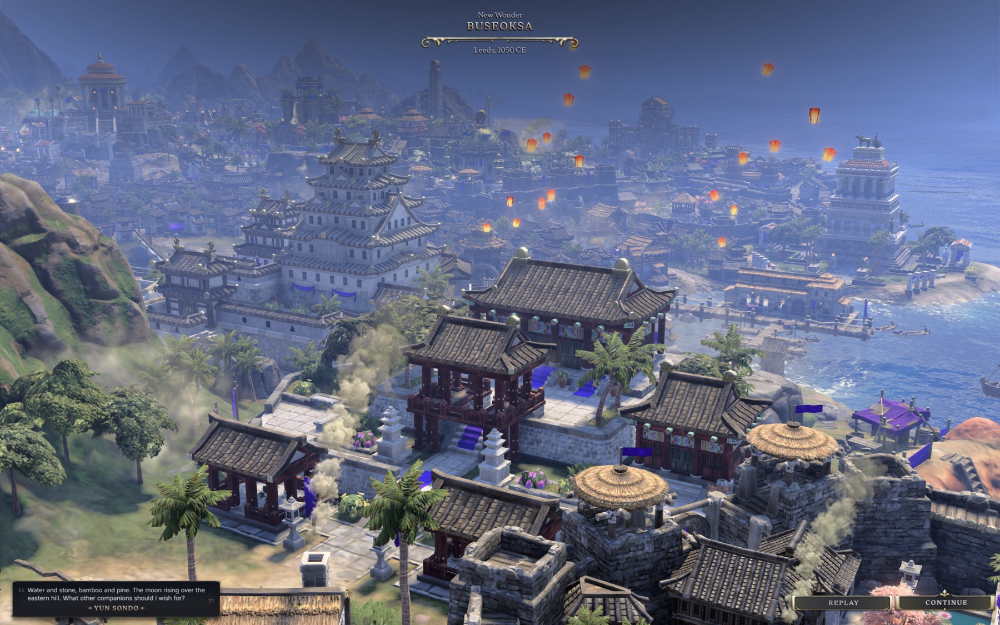
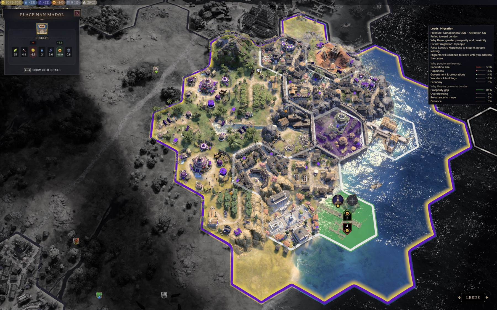
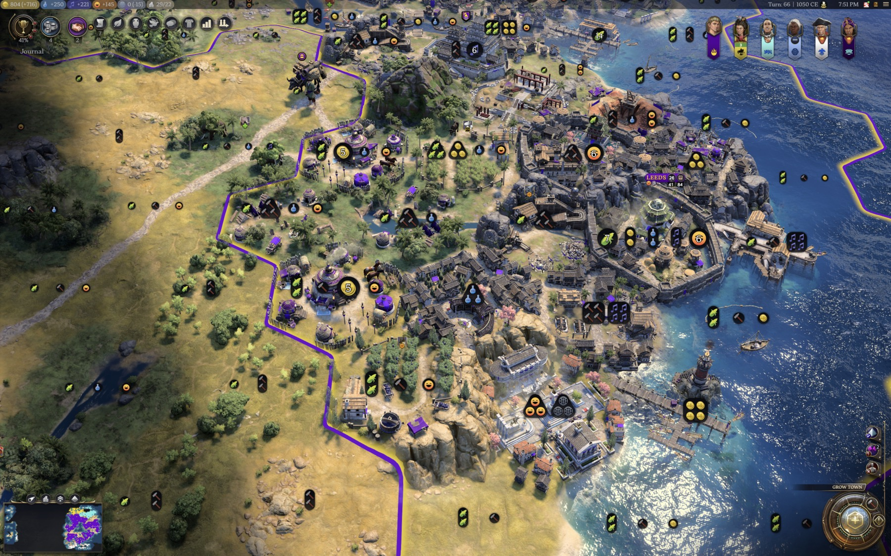

# Build Wonders Over Antiquated Buildings

A Civilization VII mod. A city that filled its center in Antiquity has nowhere left to put a Wonder. This mod
lets you build one over the buildings that age left behind: urban tiles whose buildings are all from an earlier
age are offered on the Wonder placement screen, the old buildings are cleared, the walls stay, and the citizens
they housed are yours to place through the game's own Grow City prompt.



*The game's own Wonder cinematic for a Wonder built this way. It is an ordinary Wonder: the tile is a real
`DISTRICT_WONDER`, and nothing about Wonders is redefined anywhere.*

There is no database change. Wonders keep their class, their one-in-the-world uniqueness, their cinematics, their
terrain rules, the adjacency their neighbors read from a Wonder district, and whatever the AI does with them. The
mod clears a tile and lets the game build on it, exactly as the game would build on any bare tile.

---

## What the player does

Pick a Wonder in production. Urban tiles holding only antiquated buildings now show as valid sites alongside the
usual ones.



*The placement screen, with the mod's tile selected and the yield result the mod computes for it.*

Choose one, exactly as you would choose an empty tile; the mod adds no prompt of its own. The buildings'
demolition, the district's demolition and the Wonder's build order all go to the game in the same instant, so the
tile goes straight from its old buildings to the Wonder's construction site and no empty ground is ever drawn.
Walls come down with the district and are re-created on the Wonder's district a moment after it lands. Once the
Wonder is standing, one citizen per building that housed one becomes pending population, and before the turn can
end the game's own Grow City prompt asks where each settles: a rural tile or a specialist seat, wherever you
like.



*The displaced citizens arrive as ordinary pending population, placed on the game's own screen. The city's head
count is unchanged once they are placed.*

## Which tiles qualify

| Tile holds | Offered |
| --- | --- |
| one antiquated building, free slot or not | yes |
| two or more antiquated buildings | yes |
| one antiquated beside one current-age | no |
| two current-age | no |
| anything Ageless (the Palace, the City Hall, a Harbor, unique-quarter buildings, Wonders) | no |
| walls, alongside any of the above | walls neither qualify a tile nor block it, and are kept |

Antiquated means a previous age and not Ageless, or two ages back if you pick that in the options below. The engine
enforces none of this on its own; left alone it offers any terrain-valid urban tile whatever stands on it. So this
rule is the only thing that decides what is ever cleared. It lives in `lib/bwab-eligibility.js` with 45 tests.

## Options

Options > Add-ons has a **Build Wonders Over Antiquated Buildings** header with two settings, in the main menu and in
a game:

| Setting | Choices | Default |
| --- | --- | --- |
| Offer antiquated tiles for Wonders | on, off | on |
| Antiquated means | From any earlier age, From two ages back | From any earlier age |

Turn the first off and a Wonder's placement screen shows only the game's own sites. A clear that's already under way
still finishes. "From two ages back" counts only buildings from two ages ago: in the Modern age a tile of Antiquity
buildings is offered and a tile holding an Exploration building isn't, and in the Exploration age you'll see only the
game's own sites. Ageless buildings and walls work the same under both choices, and the second setting is greyed out
while the first is off.

The settings are yours rather than the save's. They're kept in the shared settings store that the bundled Tower
Settings Keeper keeps readable, so they hold across a restart, and a save loads the same whatever they're set to. The
mod reads them once and keeps them in memory, because the placement hook runs for every item in the production list.
The design and the checks it still needs in a game are in [docs/OPTIONS.md](docs/OPTIONS.md).

## Which Wonders are offered a tile

The mod decides *where* a Wonder may go, not *whether* one may be built. A Wonder that is locked, not yet
unlocked, or already standing somewhere in the world stays refused, exactly as the base game refuses it. Only a
refusal that says there is nowhere to put it is this mod's business.

In one city, of 48 Wonders, 2 were buildable, 42 were refused for reasons that have nothing to do with any tile,
and 4 were refused for want of a site. Only those last 4 are ones this mod can help with.

Every Wonder's own placement rules are then checked tile by tile, from the game's data: terrain, biome, the
feature it needs or can't have, a resource, river and lake rules, homeland or distant lands, what the six
neighbouring tiles hold (terrain, a district, a mountain, a lake, a building, the capital, a resource, land beside
water) and a building the settlement must already have. A Wonder is offered every antiquated tile that meets its
rules, and only those. So Rila Monastery gets the antiquated tiles at the edge of a city that have no urban tile or
city center beside them. Shwedagon Zedi Daw and Muzibu Azaala Mpanga get the ones beside a lake, Ubudiah Mosque
the ones on a wet feature such as a marsh, and Battersea Power Station the ones beside Coast.

The Wonders that stand on Coast follow placement rules the game keeps to itself, so for a coastal urban tile (a
Lighthouse or Fishing Quay) the game is asked as well. Nan Madol, Hale o Keawe, Havana Harbor and the Statue of
Liberty are offered such a tile when the game already accepts the Wonder on a bare coast tile of the same city and
the tile meets the rules the data does spell out.

## If the game refuses the site after all

Civilization VII will not say whether a Wonder fits a tile until the tile is empty, and it enforces placement
rules that are not in the data a mod can read. So a cleared tile can still be turned down.

The build order goes to the game together with the clear, so a refusal shows up as the tile failing to become a
Wonder site. The mod watches the tile for about three seconds; if the Wonder has not appeared by then, it puts
the tile back: the buildings it destroyed are re-created, then the walls, and it reads the tile afterward to
confirm everything is standing. No citizens are displaced, because they are only added once the Wonder is on the
tile. The hex is empty for those few seconds and then holds what it held before. On a coastal Wonder whose every
readable rule passed and which the engine still refused, the tile came back holding its Lighthouse, with
population, urban and rural counts unchanged and nothing left pending. A refusal costs a few seconds of empty hex
and nothing else.

## The yield preview

A tile the mod adds is not one the engine prepared placement data for, so the placement panel has nothing of its
own to show for it. The mod answers with its own figure, built from the game's per-constructible numbers: the
Wonder's base yields, minus the yields of the buildings that would go, plus the maintenance they would stop
costing.

It is a first-order figure. Yields a Wonder grants conditionally, and adjacency the old buildings were receiving,
are not modeled. No Wonder in the game has adjacency rows of its own, which is why the Wonder side of the
subtraction is exact.

## What it costs you

The tile. Those buildings' yields and maintenance are gone, the city has fewer building slots, and the tile holds
the Wonder from then on. The citizens are not lost: the head count is unchanged once you have placed them.

## Compatibility

- No database change, so a save loads with the mod on or off, and it can join a game already in progress. A
  Wonder built this way is ordinary constructible state.
- No base-game files are replaced, and mods that adjust Wonder data are unaffected, because this mod does not
  touch Wonder data.
- The clear and the build are the local player's own actions on the local player's own settlement. The AI builds
  Wonders exactly as it always has.
- Multiplayer works. In a LAN game the clear, the build and the displaced citizens all went through the network
  session, and a competing placement was refused by the game and rolled back intact.
- The text is in English, German, Spanish, French, Italian, Japanese, Korean, Polish, Portuguese (Brazil), Russian
  and Chinese (Simplified and Traditional), following the game's language setting.

## Installation

1. Subscribe on the Steam Workshop, or download the zip from the
   [latest release](https://github.com/tmtmiller1/civilization-vii_build_wonders_over_antiquated_buildings/releases/latest).
2. Unzip it so the `build-wonders-over-antiquated-buildings` folder sits in the Civilization VII Mods directory.
3. Enable **Build Wonders Over Antiquated Buildings** from Additional Content in-game.

## Status

Works end to end on Civilization VII 1.5.0 as of 2026-09-24: a real mouse click on the hex, the one-building and
two-building cases, walls kept on a hill tile, population conserved on both, the click going straight to the clear
with no prompt of the mod's own, the yield preview on the hex and in the panel, a refusal rolling the tile back
with nothing lost, a live LAN game, and the tile going from its buildings straight to the Wonder's construction
site with no empty ground in between. Each step and the run behind it is in [docs/RECIPE.md](docs/RECIPE.md).

The two options were watched in a game on 2026-10-15: the switch and the age rule in Options > Add-ons do what
their labels say. What a run covers is listed at the end of [docs/OPTIONS.md](docs/OPTIONS.md).

The per-tile check for every Wonder rule is built and covered by the offline tests. The in-game comparison with the
game's own sites, Wonder by Wonder, is the `pb27` run in [docs/RECIPE.md](docs/RECIPE.md), under "What is still
open".

## Layout

```
build-wonders-over-antiquated-buildings.modinfo   one game script and the Options rows, no data
ui/bwab-clear-and-build.js          the mod: placement hooks, the clear, walls, yield preview, rollback
ui/bwab-settings.js                 the two settings: defaults, read once and kept, the guarded write
ui/bwab-options.js                  the two rows in Options > Add-ons
ui/settings-keeper.js               Tower Settings Keeper BUILD 112, copied unchanged
lib/bwab-eligibility.js             the tile rule and every Wonder placement rule, 45 tests
text/en_us/ModText.xml              name, description and the Options text
text/<lang>/ModText.xml             the same text in each of 11 other languages
tests/eligibility.mjs               the rule's tests
tests/settings.mjs                  the settings' tests (11)
docs/RECIPE.md                      each engine step and the run behind it
docs/OPTIONS.md                     the two options, where they're kept, and the lab checks they need
docs/steam-workshop-description.md  the Workshop page text
docs/logo.svg, docs/logo.png        the Workshop preview image
gallery/                            the screenshots used above
devtools/README.md                  where the harness lives (mod_ideas_tested) and how to re-verify
eslint.config.js, tsconfig.json, types/, package.json, scripts/   dev tooling, not shipped
install-dev.sh                      copies the mod into the game's Mods folder
release.sh                          builds dist/: release zip, Workshop preview, steamcmd manifest
CHANGELOG.steam.txt                 the Workshop change notes, built from CHANGELOG.md
```

`npm run verify` runs everything that can be checked without the game: `tsc --noEmit` over the JSDoc types,
`eslint ui lib`, and the eligibility and settings tests. Zero errors and zero warnings is the bar.
`npm run readme:pdf` builds `README.pdf` from this file.

In a running game, `globalThis.__bwab.enabled = false` makes every hook pass straight through,
`globalThis.__bwab.uninstall()` restores the engine's own methods, and `globalThis.__bwab.settings()` shows the
options as the script holds them; all three are for troubleshooting.

The routes that were tried and set aside, the probes, and the harness runs live in the author's working tree
(`mod_ideas_tested/build_wonders_over_antiquated_buildings`), outside this repository; `devtools/README.md` lists
the runs that verify this build.

## Credits

Built by Tower. MIT licensed.
